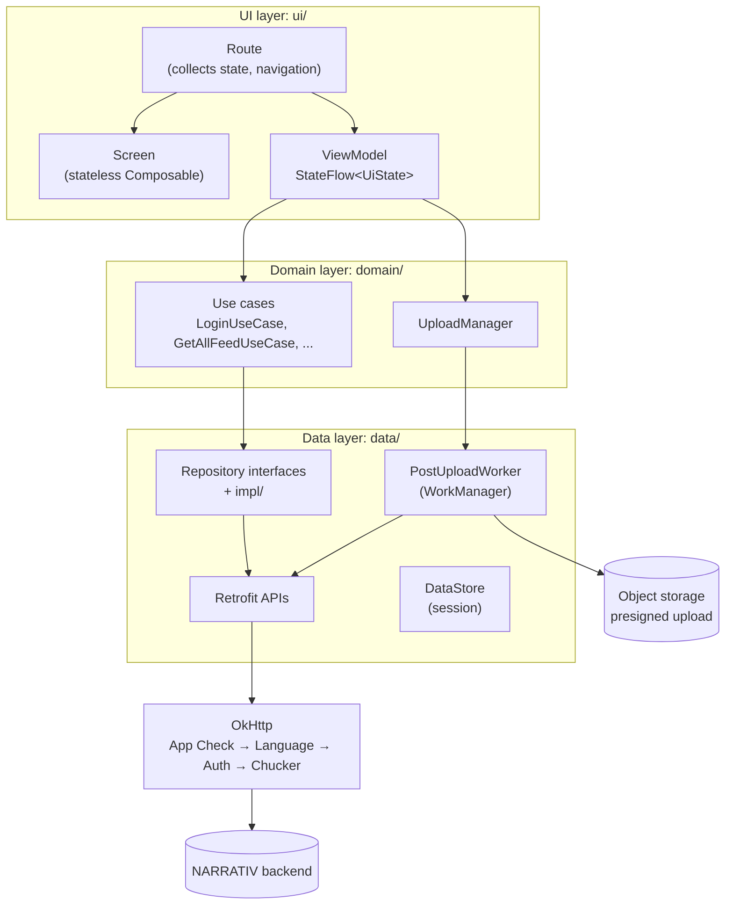

# NARRATIV for Android

NARRATIV is a social app for sharing short stories with photos and videos: post, follow people, like, comment and get notified. This repository is the native Android client, written in Kotlin with Jetpack Compose. It is built for release on Google Play and talks to a separate backend that is not part of this repository.

> The source is public for review only. It is not open source: see [LICENSE](LICENSE).

## Features

**Account**
- Sign up with email and password, verified by a one-time code (OTP), or sign in with Google (Credential Manager)
- Password reset via OTP, email change, and account deletion
- Sessions that survive restarts, with silent token refresh

**Feed and posts**
- Home feed and an Explore grid, with cursor-based paging so new posts never show up twice while scrolling
- Posts with a caption and several photos or videos; media is compressed on the device before upload (Media3 Transformer for video, a bitmap pipeline for images)
- Uploads run in the background with a progress banner and notification, and survive navigation, process death and lost connectivity
- Swipeable media viewer, video playback with a disk cache (ExoPlayer), likes with optimistic updates

**Conversation**
- Threaded comments with replies, emoji picker, swipe to delete
- The author can pin a comment, and readers can quote a part of the caption in a reply

**People**
- Profiles with an avatar you can crop and filter, followers and following lists, user search
- Report posts or users, block users, and manage blocked accounts

**Notifications**
- Push notifications via Firebase Cloud Messaging that open the right post or profile
- In-app notification list grouped by time, with an unread badge

**App**
- English and Indonesian, switchable per app (Android 13 language settings with a fallback below that)
- Onboarding, settings, legal pages, opt-out of usage data
- Forced update through Firebase Remote Config, failing open when the config cannot be fetched

## Tech stack

| Area | Libraries |
|---|---|
| UI | Jetpack Compose, Material 3, Navigation Compose, Coil, Lottie |
| Architecture | MVVM, Hilt, Kotlin Coroutines and Flow |
| Networking | Retrofit, OkHttp, Gson |
| Persistence | DataStore (Preferences) |
| Background work | WorkManager with Hilt workers, foreground service for uploads |
| Media | Media3 ExoPlayer, Media3 Transformer, ExifInterface |
| Auth | Credential Manager + Google ID, AppAuth |
| Firebase | Cloud Messaging, Crashlytics, Analytics, Performance, Remote Config, App Check (Play Integrity) |
| Debugging | Chucker (debug builds only), OkHttp logging |
| Testing | JUnit 4, Robolectric, Turbine, Truth, MockWebServer, WorkManager testing, Compose UI test, Kover |

Kotlin 2.2, AGP 8.10, min SDK 26, target SDK 36, Java 17. All versions live in the [version catalog](gradle/libs.versions.toml).

## Architecture

The app follows the layering from Google's guide to app architecture: a **UI layer** (Compose screens and ViewModels), a **domain layer** (use cases) and a **data layer** (repositories, API and local storage). Dependencies point in one direction only, and every boundary is an interface that Hilt binds, so each layer can be tested with fakes.



### Package layout

```
com.rizkysiregar.narrativ
├── ui/            Compose screens, ViewModels, navigation graphs, theme, shared components
│   ├── feature/   one package per feature: auth, home/{feed,explore,profile,...}, settings, moderation, ...
│   ├── main/      root scaffold and navigation (auth, onboarding, home, legal graphs)
│   └── base/      BaseViewModel, BaseScreen
├── domain/        use cases and domain rules (auth, feed, post, profile, user, moderation)
├── data/
│   ├── remote/    Retrofit APIs, request/response models, interceptors, token refresh, workers
│   ├── repository/  repository interfaces and their impl/
│   ├── session/   SessionManager, Google ID token provider, remote sign-out
│   └── cache/     DataStore wrapper, in-memory JWT holder
├── di/            Hilt modules (network, DataStore, coroutines, clock, telemetry, services)
├── media/         image and video compression, avatar crop and filter, video cache
├── notification/  FCM service, push and upload notifications
├── telemetry/     analytics, crash and performance tracing behind interfaces
├── config/        Remote Config (force update)
├── appcheck/      Firebase App Check setup and interceptor
└── i18n/          AppStrings (string resources outside Compose) and locale switching
```

### Patterns worth a look

- **Unidirectional data flow.** Each ViewModel exposes one immutable `StateFlow` of UI state, and Compose screens are stateless: a *Route* collects state and handles navigation, a *Screen* only renders. Results travel as a sealed `ResultState` (`Idle`, `Loading`, `Success`, `Failure`).
- **Use cases as single operations.** Each user action is one small class with `operator fun invoke`, so ViewModels depend on intent, not on repositories.
- **Authentication in the network layer.** [`AuthInterceptor`](app/src/main/java/com/rizkysiregar/narrativ/data/remote/AuthInterceptor.kt) adds the bearer token and, on a 401, asks [`TokenRefresher`](app/src/main/java/com/rizkysiregar/narrativ/data/remote/TokenRefresher.kt) for a new pair. Refresh tokens are single use, so refreshing is serialized: when many requests fail at once, only the first refreshes and the rest reuse its result. A rejected refresh expires the session through [`SessionManager`](app/src/main/java/com/rizkysiregar/narrativ/data/session/SessionManager.kt), which the UI observes to return to the login screen.
- **Uploads that cannot get lost.** [`WorkUploadManager`](app/src/main/java/com/rizkysiregar/narrativ/domain/post/WorkUploadManager.kt) hands a post to WorkManager as the single source of truth. The worker asks the backend for presigned URLs, streams each file straight to object storage with progress ([`PresignedUploader`](app/src/main/java/com/rizkysiregar/narrativ/data/remote/upload/PresignedUploader.kt)), then creates the post. Retries use exponential backoff and wait for a network connection.
- **Shared paging.** [`BaseFeedViewModel`](app/src/main/java/com/rizkysiregar/narrativ/ui/feature/home/feed/BaseFeedViewModel.kt) pages the list and the media grid as two independent streams, and keeps likes in sync between them. Home, Explore, profile and user detail all extend it.
- **SDKs behind interfaces.** Firebase, Credential Manager and media inspection sit behind small interfaces (`AppAnalytics`, `CrashReporter`, `GoogleIdTokenProvider`, `PushTokenProvider`, `RemoteConfigManager`, ...), so the logic around them runs in plain JVM tests.
- **Injected time and dispatchers.** A `Clock` and coroutine dispatchers come from Hilt, so time-based rules (OTP resend windows, sync intervals) and coroutines are tested deterministically.

## Build variants

| Flavor | Backend | Firebase project |
|---|---|---|
| `local` | `http://10.0.2.2:9091` (a backend on the host, seen from the emulator) | development |
| `dev` | development server | development |
| `prod` | production server | production |

Each flavor has its own `google-services.json` under `app/src/<flavor>/`. The `debug` build type uses the App Check debug provider and keeps telemetry off. `release` turns on R8 shrinking and Play Integrity.

## Getting started

Requirements: Android Studio (recent stable), JDK 17 or newer.

```bash
git clone https://github.com/rizkysiregar/narrativ-android.git
cd narrativ-android
make help          # list the build helpers
make build-dev     # assemble the dev debug APK
make test          # run the unit tests
```

The app needs the NARRATIV backend, which is not public, so a build from this repository compiles and runs but can only reach the servers configured in `app/build.gradle.kts`. Release signing reads `keystore.properties` (see [`keystore.properties.example`](keystore.properties.example)) or the `KEYSTORE_*` environment variables. Neither is committed, and without them the release build is simply left unsigned.

## Testing and quality

- **Unit tests** for ViewModels, use cases, repositories, workers, interceptors and the session, using fakes, Robolectric where Android is needed, and MockWebServer for the full HTTP auth stack.
- **API contract tests** check that request and response models match JSON fixtures.
- **Coverage floors per area** (network, session, repositories, auth, uploads, ...) enforced by a Gradle task on top of Kover, so coverage of risky code can only go up. See [`docs/TEST_PLAN.md`](docs/TEST_PLAN.md) for the risk-based plan behind them.
- **Lint** fails the build on any new warning, with existing ones frozen in a baseline.
- **CI** ([GitHub Actions](.github/workflows/ci.yml)) runs unit tests, lint and coverage floors on every pull request, and builds the R8 release on every merge to `master`.

```bash
./gradlew :app:testDevDebugUnitTest :app:lintDevDebug :app:verifyCoverageFloors
```

## Security notes

- **No secrets in the repository.** Signing keys, keystore passwords and `local.properties` are git-ignored.
- **The `google-services.json` files are committed on purpose.** The Firebase API key inside them identifies the project and ships in every APK; it is not a secret. Access is protected by API key restrictions (package name and signing certificate), Firebase App Check with Play Integrity, and server-side authentication.
- **HTTPS only.** Cleartext traffic is disabled, except to the emulator host in the `local` flavor.
- **No backups of the session.** Tokens are excluded from cloud backup and device transfer.
- **Debug only:** request logging and the Chucker inspector are debug-only and redact auth headers. Release builds strip verbose logs.
- **Ad ID permissions are removed.** The app shows no ads.

## Author

Habib Rizky Almajid Siregar. [GitHub](https://github.com/rizkysiregar)
